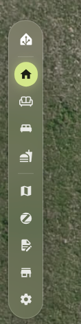
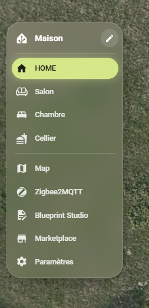
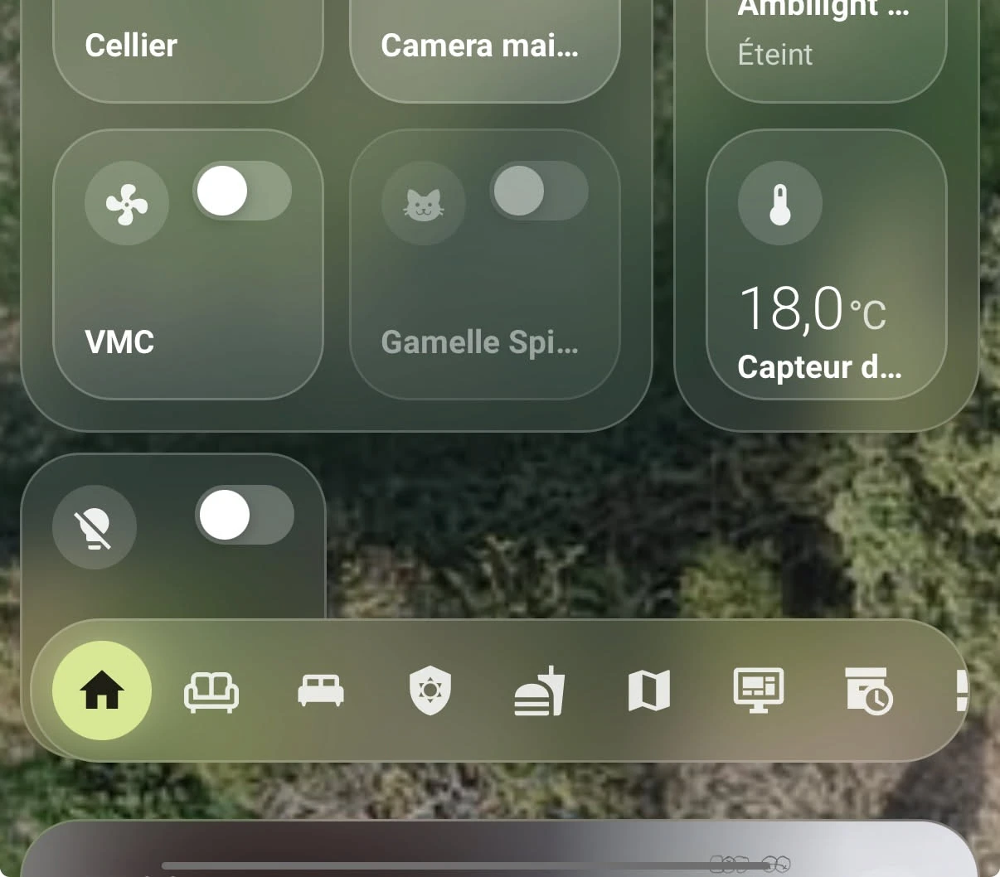
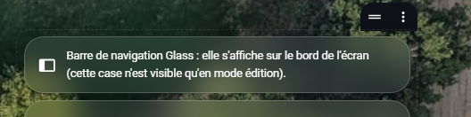

# Glass Nav Card

Barre de navigation flottante en verre pour Home Assistant. Elle remplace la barre latérale grise et le bandeau d'onglets sur vos tableaux de bord.

<p>
  
  &nbsp;&nbsp;
  
</p>

- Pilule en verre posée sur le bord de l'écran : icônes seules, **dépliée avec les noms** au survol (ou en touchant l'icône du haut).
- Page en cours surlignée, couleur au choix.
- **Remplissage automatique** : les vues du tableau de bord, puis les pages de la barre latérale de HA (Carte, Énergie, Historique, Paramètres…).
- Masque la barre latérale et les onglets de HA uniquement sur le tableau de bord. Ils reviennent ailleurs et en mode édition.
- Sur téléphone : barre horizontale en bas de l'écran.
- Crayon ✏️ à côté du titre pour passer en mode édition.
- Choix des pages affichées, éditeur visuel, aucune dépendance.



Va très bien avec [Glass Card](https://github.com/mrcouscous49-ui/glass-card).

## Choisir les pages

Dans l'éditeur visuel, la liste **Pages affichées dans la barre** propose toutes vos vues et pages : décochez celles que vous ne voulez pas. Pour choisir aussi l'ordre, utilisez plutôt `items` (voir *Liens manuels*).

## Installation

**Marketplace (recommandé)** : Glass Nav Card fait partie du catalogue officiel. Dans **Paramètres → Marketplace** (ou **HACS** avant Home Assistant 2026.11), cherchez **Glass Nav Card** → **Télécharger**, puis rechargez la page (Ctrl+F5).

**Dépôt personnalisé** (si la carte n'apparaît pas dans la recherche) : Paramètres → Marketplace → ⋮ → Dépôts personnalisés → `https://github.com/mrcouscous49-ui/glass-nav-card`, type **Tableau de bord**, puis installez **Glass Nav Card** et rechargez la page.

**Manuelle** : copiez `glass-nav-card.js` dans `/config/www/`, puis ajoutez la ressource `/local/glass-nav-card.js` (type module) dans Paramètres → Tableaux de bord → ⋮ → Ressources.

## Utilisation

La barre ne s'installe pas toute seule : il faut **l'ajouter comme une carte** dans votre tableau de bord.

1. Passez le tableau de bord en mode édition (crayon en haut à droite).
2. **Ajouter une carte** → cherchez **Glass Nav Card**, ou collez le YAML ci-dessous dans une carte « Manuel ».
3. Placez-la n'importe où dans la vue, par exemple en bas d'une section.

En mode édition, la carte apparaît sous forme de case : c'est là que vous la modifiez. Hors mode édition, la case disparaît et seule la barre s'affiche sur le bord de l'écran.




```yaml
type: custom:glass-nav-card
title: Maison
icon: mdi:home-assistant
```

Astuce : collez la même carte dans chaque vue, pour que la barre apparaisse même si la page est rechargée directement sur cette vue.

**Modifier le tableau de bord** : touchez le crayon ✏️ à droite du titre, en haut de la barre dépliée. Les barres de HA réapparaissent et le mode édition s'ouvre ; elles se masquent de nouveau quand vous cliquez sur « Terminé ». Un appui long sur l'icône du haut affiche ou masque aussi les barres de HA.

### Options

| Option | Défaut | Description |
|---|---|---|
| `title` | `Menu` | Texte affiché en haut quand la barre est dépliée |
| `icon` | `mdi:menu` | Icône du haut (déplie la barre, appui long = barres HA) |
| `items` | automatique | Liste manuelle de liens (voir ci-dessous) |
| `show_views` | `true` | Ajouter les vues du tableau de bord |
| `show_panels` | `true` | Ajouter les pages de la barre latérale de HA |
| `hide_items` | aucun | Chemins à retirer de la liste automatique (cases « Pages affichées » de l'éditeur) |
| `hide_sidebar` | `true` | Masquer la barre latérale de HA |
| `hide_header` | `true` | Masquer le bandeau d'onglets de HA |
| `show_edit` | `true` | Bouton ✏️ « Modifier le tableau de bord » (administrateurs) |
| `position` | `left` | `left` ou `right` |
| `mobile_bottom` | `true` | Barre en bas de l'écran sur téléphone |
| `color` | `[212, 232, 138]` | Couleur du surlignage (RVB) |
| `blur` / `opacity` | `20` / `12` | Flou (px) et opacité (%) du verre |

### Liens manuels

```yaml
type: custom:glass-nav-card
title: Maison
items:
  - name: Accueil
    icon: mdi:home
    path: /dashboard-maison/home
  - name: Sécurité
    icon: mdi:shield-home
    path: /dashboard-maison/securite
  - name: Énergie
    icon: mdi:lightning-bolt
    path: /energy
  - name: Paramètres
    icon: mdi:cog
    path: /config
```

Un `path` qui commence par `https://` s'ouvre dans un nouvel onglet.

## Licence

MIT
